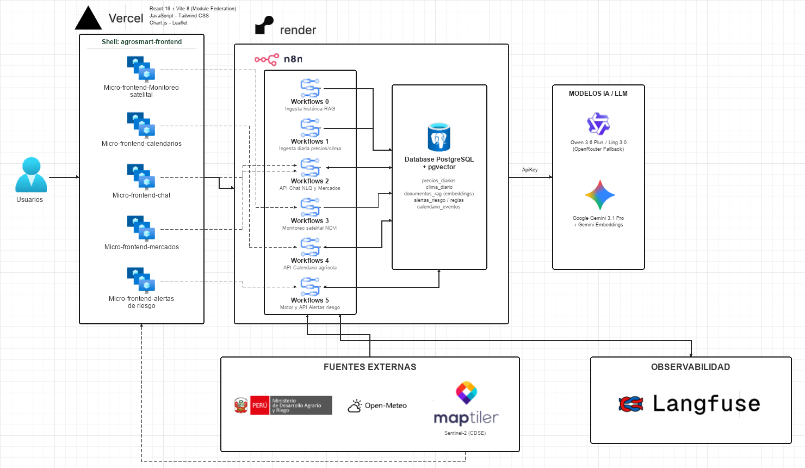

# Arquitectura general

Este diagrama presenta la arquitectura general actualizada de **AgroSmart Insights**, incorporando el contenedor principal (**Shell con Module Federation**), los **cinco microfrontends independientes** desplegados en Vercel y su integración con los **workflows de n8n** alojados en Render y la base de datos **PostgreSQL + pgvector**.

---

## Microfrontends implementados y su conexión con Workflows (n8n)

El frontend está estructurado bajo una arquitectura de **Microfrontends con `@originjs/vite-plugin-federation`**, donde la aplicación contenedora (`agrosmart-frontend`) carga dinámicamente cinco módulos remotos independientes y cada uno se comunica con su respectivo workflow o servicio en **n8n**:

| Microfrontend | Directorio / Puerto local | Componente expuesto | Workflow / Servicio conectado | Endpoint / Contrato |
| :--- | :--- | :--- | :--- | :--- |
| **Shell (Host)** | `src/frontend/agrosmart-frontend` (`:5173`) | Contenedor principal (`App.jsx`) | Orquestador de vistas y `MicrofrontendErrorBoundary` | Consume los `remoteEntry.js` de los 5 microfrontends remotos |
| **Chat NLQ** | `src/frontend/chat-microfrontend` (`:5174`) | `chat/ChatApp` | **WF2** — API Chat y Análisis Predictivo | `POST /webhook/v1/query` (`VITE_N8N_WEBHOOK_URL`) con `{ pregunta, session_id }` |
| **Monitoreo Satelital** | `src/frontend/monitoreo-microfrontend` (`:5175`) | `monitoreo/MonitoreoSatelital` | **WF3** (NDVI Sentinel-2), **WF2** (riesgo agroclimático), **Open-Meteo** y **MapTiler** | `POST /webhook/v1/satelital/ndvi` (`VITE_WF3_NDVI_URL`) y `POST /webhook/v1/query` (`action: "analisis_satelital_riesgo"`) |
| **Mercados MIDAGRI** | `src/frontend/mercados-microfrontend` (`:5176`) | `mercados/MercadosMIDAGRI` | **WF2** — Comparativa de precios GMML vs. MMF2 | `POST /webhook/v1/query` (`action: "get_market_prices"`, `tipo: "mercados"`, `mercados: ["GMML", "MMF2"]`) |
| **Alertas de Riesgo** | `src/frontend/alertas-microfrontend` (`:5177`) | `alertas/AlertasRiesgo` | **WF5** — Motor y API de Alertas de Riesgo Agrícola | `POST /webhook/v1/alertas` (`VITE_ALERTS_WEBHOOK_URL`) con `{ action: "list" \| "details" \| "update", session_id }` |
| **Calendario Agrícola** | `src/frontend/calendario-microfrontend` (`:5178`) | `calendario/CalendarioAgricola` | **WF4** — API de Calendario Agrícola MIDAGRI | `GET /webhook/v1/calendario` (`VITE_CALENDARIO_API_URL`) con filtros `desde`, `hasta`, `departamento`, `modalidad`, `entidad`, `q` |

---

## Resumen de Workflows en n8n (Render)

| Workflow | Archivo / Identificador | Disparador (Trigger) | Responsabilidad principal |
| :--- | :--- | :--- | :--- |
| **WF0** | `wf0-ingesta-historica-midagri-gmml.json` `wf0-ingesta-historica-midagri-mmf2.json` | Manual / Bajo demanda | Ingesta histórica de boletines MIDAGRI (GMML y MMF2) e indexación documental semántica en `documentos_rag` (pgvector) y `precios_diarios`. |
| **WF1** | `wf1-ingesta-diaria-precios-clima.json` | Cron diario (10:00–13:00 `America/Lima`) | Ingesta automatizada diaria de precios mayoristas MIDAGRI (GMML + MMF2) y pronósticos climáticos de 14 regiones vía Open-Meteo hacia `precios_diarios` y `clima_diario`. |
| **WF2** | `wf2-api-chat-analisis-predictivo.json` | Webhook `POST /v1/query` | Clasificación de intención, consultas SQL de precios/volumen, recuperación vectorial RAG, predicción con Google Gemini 3.1 Pro / OpenRouter (Ling 3.0 Flash) y trazabilidad en Langfuse. Atiende a **Chat NLQ**, **Mercados** y respaldo de **Monitoreo**. |
| **WF3** | Servicio Satelital NDVI | Webhook `POST /v1/satelital/ndvi` | Procesamiento de capas espectrales NDVI (Copernicus Sentinel-2 CDSE) e indicadores geoespaciales para **Monitoreo Satelital**. |
| **WF4** | Servicio de Calendario Agrícola | Webhook `GET /v1/calendario` | Consulta filtrada de eventos, ferias y campañas agrícolas de MIDAGRI por rango de fechas, departamento, modalidad y entidad para **Calendario Agrícola**. |
| **WF5** | `wf5-alertas-riesgo.json` | Cron lun–sáb 14:00 + Webhook `POST /v1/alertas` | Evaluación periódica de reglas de riesgo en PostgreSQL (`alertas_riesgo_evaluar`) y API para listar alertas, consultar evidencia histórica y actualizar estados (`pending`, `read`, `attended`) desde **Alertas de Riesgo**. |
